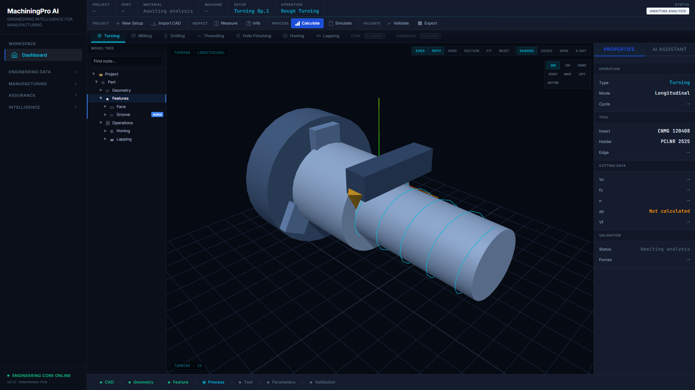

# MachiningPro AI

### Engineering Intelligence for Machining & Manufacturing Planning

MachiningPro AI is an engineering decision-support platform that connects technical drawings and CAD data with machining process planning in a traceable manufacturing workflow.

<p align="center">
  
</p>

---

## Real IGES Engineering Demo

This demo uses a synthetic, non-proprietary IGES model processed through the real MachiningPro pipeline — no customer data, no proprietary geometry.

### English Demo

[▶ Watch MachiningPro AI Real IGES Demo — English](assets/MachiningPro_AI_DEMO_EN.mp4)

### Türkçe Demo

[▶ MachiningPro AI Gerçek IGES Demosunu İzle](assets/MachiningPro_AI_DEMO_TR.mp4)

---

## Current Capabilities

- CAD / IGES engineering data analysis
- 3D manufacturing feature recognition
- Feature highlighting and feature-tree visualization
- Dimensional and tolerance interpretation
- GD&T and datum intelligence
- Drawing-to-CAD feature association
- Alternative machining process route generation
- Machine / cutting-tool / holder candidate evaluation
- Process capability assessment
- Cycle-time analysis
- Manufacturing Plan generation
- Inspection Plan foundation
- Control Plan foundation
- Engineering traceability
- JSON / CSV / HTML engineering exports
- Turkish / English interface

---

## Engineering Workflow

```
IGES / Drawing
→ Engineering Requirements
→ 3D Feature Recognition
→ GD&T Intelligence
→ Alternative Process Routes
→ Process Capability
→ Cycle Time
→ Manufacturing Plan
→ Inspection & Control
→ Traceable Export
```

---

## 3D Feature Intelligence

The current demo visualizes imported geometry and highlights recognized manufacturing features such as:

- Holes
- Precision diameters
- Bores
- Slots
- Pockets
- Machining-related geometry

Selected features can be linked to dimensions, tolerances, datums, GD&T requirements, and manufacturing context.

---

## Process Planning Intelligence

MachiningPro AI supports engineering evaluation of:

- Alternative process routes
- Setup strategies
- Machine candidates
- Cutting-tool candidates
- Tool-holder candidates
- Process capability
- Cycle-time components
- Manufacturing sequence
- Inspection requirements

---

## Engineering Principle

MachiningPro AI is currently an:

**Engineering Decision-Support System**

Engineering review and approval remain mandatory.

The current release does NOT claim:

- Autonomous engineering approval
- Automatic CAM toolpath generation
- Collision-verified machining simulation
- Automatic NC execution
- Automatic production release

---

## Current Demo Release

**MachiningPro AI 0.5.0-demo**

---

## Technology

- Python
- FastAPI
- React
- TypeScript
- Three.js
- Engineering rule engines
- Deterministic manufacturing logic
- CAD / IGES interoperability

---

## Target Users

- Manufacturing Engineers
- Process Engineers
- CNC / Machining Engineers
- Industrialization Engineers
- Quality Engineers
- Supplier Development Engineers
- OEM Engineering Teams
- Tier-1 Engineering Teams

---

## Vision

**From Drawing & CAD Intelligence to Manufacturing Planning**

The long-term objective is to build a traceable engineering environment that supports manufacturing decisions from product definition through process planning and industrialization.
